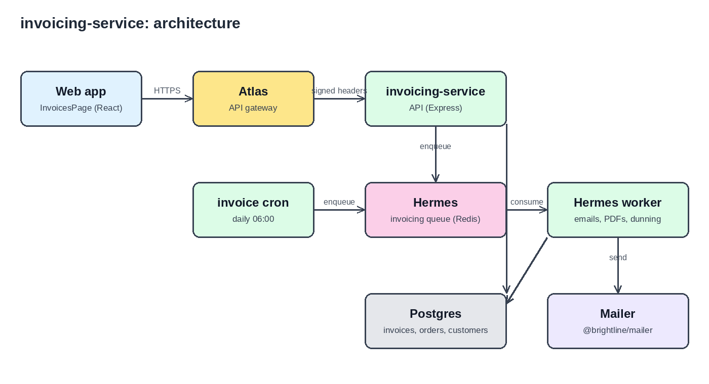

# Architecture

## Components

- **Atlas** is the API gateway. Every external request enters through Atlas. It checks the
  user's session and forwards the request with signed headers (`x-atlas-user`, `x-atlas-roles`,
  `x-atlas-signature`). The service rejects requests without a valid signature (`src/atlas/auth.ts`).
  Locally there is no Atlas, so we use `ATLAS_DEV_TOKEN` instead.
- **invoicing-service API** (`src/index.ts`, `src/atlas/routes.ts`) is a small Express app.
  It reads and writes Postgres and never calls external services directly.
- **Hermes** is the invoicing queue. It is a Redis-backed BullMQ queue (`src/hermes/queue.ts`).
  Jobs that send invoices go through it: `invoice.email`, `invoice.pdf`, `invoice.dunning`.
  We chose a queue in [ADR-007](docs/adr/ADR-007-hermes-for-invoice-delivery.md).
- **Hermes worker** (`src/hermes/worker.ts`) consumes jobs and calls `notify.ts` or the PDF renderer.
  Failed jobs retry 5 times with exponential backoff, then stay in the dead-letter view (DLQ).
- **invoice cron** (`src/services/billing/invoice.cron.ts`) runs every day at 06:00.
  It issues the invoices that are due and puts their emails and PDFs on Hermes.
- **Postgres** stores customers, invoices and orders. Money is always stored in cents.
- **Beacon** is our monitoring stack (Grafana + Loki). Alerts go to `#invoicing-alerts`.

## How an invoice travels

1. At 06:00 the cron calls `issueDueInvoices()`. Postgres creates the invoices with status `issued`.
2. For each invoice, the cron adds an `invoice.pdf` job and an `invoice.email` job to Hermes.
   The job id (`email:<invoiceId>`) is the idempotency key, so a cron retry never sends twice.
3. The Hermes worker renders the PDF and stores its link.
4. The worker sends the email through the mailer and marks the invoice `sent`.
5. If the invoice is not paid, the cron adds `invoice.dunning` jobs 3, 10 and 21 days after the due date.

## Order export

Finance downloads orders per month as CSV from `GET /orders/export?month=2026-09`
(`OrderExport.ts`). Rows are streamed with a Postgres cursor, so the export never loads all
orders into memory. Only users with the `finance` role can call it.

## Roles

Roles come from Atlas: `developer`, `finance`, `support`, `admin`.
`admin` passes every role check. Support can resend invoices; finance can export.

## Decisions

| ADR | Title | Status |
|---|---|---|
| [ADR-007](docs/adr/ADR-007-hermes-for-invoice-delivery.md) | Send invoices through Hermes, not inside requests | Accepted |

ADR-001 to ADR-006 were written before this repository existed and are in the old wiki.
