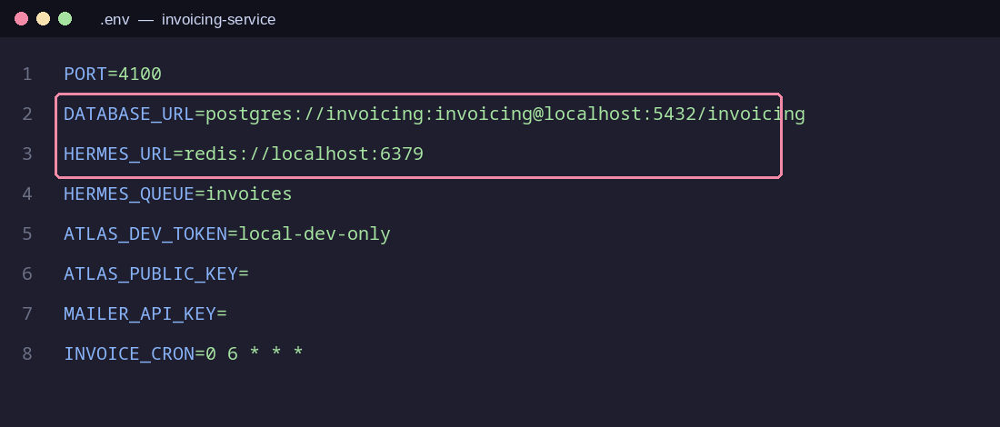
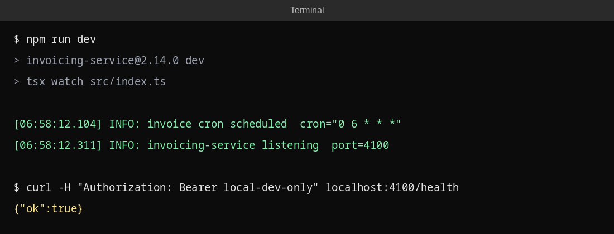

# Local setup

This guide gets invoicing-service running on your laptop. Plan about 45 minutes the first time.
Each step says how to check that it worked. If a step fails, look up the error in
[known-issues.md](known-issues.md).

## Before you start

You need: Git, Docker Desktop (or Docker Engine + Compose), and access to the
`brightline-software` GitHub organisation. Ask your buddy if you don't have access yet.

## Steps

**1. Install Node.js 20.** We use Node 20.11 or newer, but not Node 21 or 22.
The easiest way is `nvm install 20 && nvm use 20`.
Check: `node -v` prints `v20.x`.

**2. Clone the repository.**
`git clone git@github.com:brightline-software/invoicing-service.git && cd invoicing-service`

**3. Install dependencies.** `npm ci`
Check: the command ends without `ERR!` lines.

**4. Create your `.env` file.** `cp .env.example .env`
The defaults work for local development. Do not commit `.env`.

**5. Start Postgres and Redis.** `docker compose up -d`
Redis is the storage behind Hermes, the invoicing queue.
Check: `docker compose ps` shows `postgres` and `redis` as `running`.

**6. Run the migrations.** `npm run db:migrate`
Check: the output ends with `Migrations complete!`.

**7. Load demo data.** `npm run db:seed`
This creates 3 customers and 300 orders. Invoices appear after the first cron run.

**8. Start the API.** `npm run dev`
Check: the log shows `invoicing-service listening port=4100`.

**9. Start the Hermes worker** in a second terminal: `npm run worker`
Check: the log shows `Hermes worker started`.

**10. Call the API through the dev token.** Atlas does not run locally, so send the dev token:
`curl -H "Authorization: Bearer local-dev-only" localhost:4100/health`
Check: you get `{"ok":true}`.

**11. Run the tests.** `npm test`
Check: all tests pass. If a Hermes test hangs, Redis is not running (step 5).

**12. Open the Invoices page.** The web app lives in the `web-shell` repository and loads this
page as a module. Follow the README there, then open `http://localhost:5173/invoices`.

## Done?

Post "setup done" in `#team-invoicing` and tell us which step was the hardest.
We use your feedback to improve this guide.
